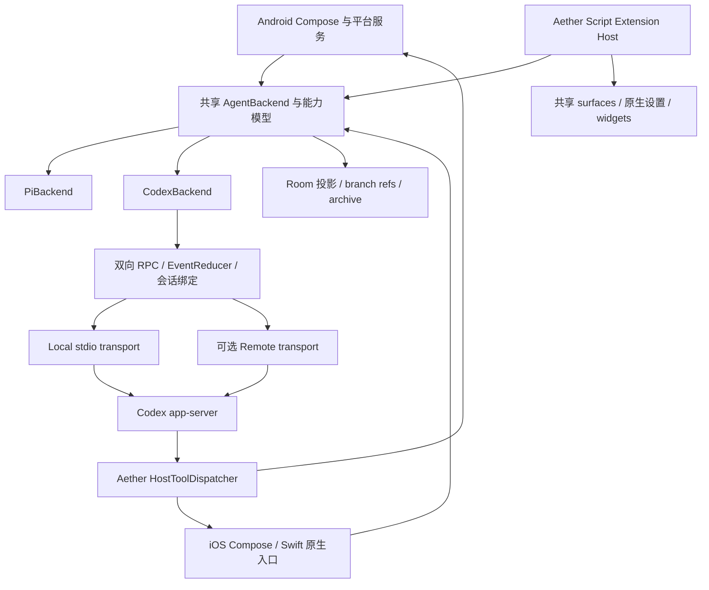

# Aether 迁移到 Codex app-server：源码研究与实施评估

研究日期：2026-10-09。本文分析迁移工作，不实施内核替换。

## 1. 结论与研究边界

**可以迁移，但这是 Agent harness、扩展生态和会话存储的迁移，不是换一个模型 API。** Aether 的 UI、文件管理器、终端、手机控制实现及部分运行时可以继续使用；Pi 的会话执行、provider 适配、扩展生命周期、分支树和桥接协议需要替换或保留兼容层。

对目前 Aether 的定位，建议先实现 **Pi / Codex 两种 backend**：Codex 承接经验证的 Responses provider，Pi 保留原有 provider 和扩展。先让 Android、iOS 的基础会话能力一致，再考虑把 Codex 设为默认。若要求完全删除 Pi、保留所有模型供应商、保留标准 Pi 扩展兼容性、同时继续两端本地运行，工程量会明显扩大，而且部分要求没有现成的 app-server API 可以完成。

核心判断：

| 判断 | 依据与实际含义 |
| --- | --- |
| app-server 适合 Aether 这样的富客户端 | 官方将认证、历史、审批、流式 Agent 事件列为其用途；它承载完整 Codex Agent 运行逻辑。[D1] |
| 它通常是运行在宿主环境的进程接口 | 默认 stdio JSONL，可连接 WebSocket；不是一个只需替换 URL 的 OpenAI 托管聊天 endpoint。[D1] |
| Aether 的手机能力可以接入 | `dynamicTools` + `item/tool/call` 可把工具执行交还 Aether；该能力仍需 experimental opt-in。[D1][C1][C2] |
| Pi 的多 provider 兼容性无法直接继承 | 当前 Codex 的 `WireApi` 只有 `responses`，`chat` 明确报错；原生 Anthropic / Gemini 协议不能只改 base URL。[C3] |
| Pi 扩展不能原样运行在 Codex | Pi 扩展调用 `ExtensionAPI`、`AgentSession`、`SessionManager`；Codex 插件、MCP 和 Rust extension API 是不同契约。[A1][A9][C12] |
| 本地运行必须先验证 iOS | Aether 使用 ARM64 iSH Linux guest；Linux musl release 存在，不代表该 guest 支持所有运行要求。[A7][C4] |
| 远程方案会改变产品的执行位置 | 默认 shell、文件工具和工作目录位于 app-server 宿主；手机 `/workspace` 不会自动变成远程工作区。 |
| 文档与 main 的接口存在变化 | 官方页仍列 deprecated `thread/rollback`；研究 commit 的 RPC 表已有 `thread/revert`，未注册 rollback。实现应锁定版本并以该版本 schema 为准。[D1][C1][C5] |

### 研究基线

- Aether：本机 `/Users/baimoqilin/Developer/Aether`，HEAD `474bb9814f7e9284e799f1305a4c7c7e2bd41c40`。工作区已有大量未提交修改，本文按**当前工作区**分析，尤其包含 Phone Use 的新实现；不能用远程 HEAD 替代这些代码。
- Pi 依赖：`pi-bridge/package.json` 中 `@earendil-works/pi-agent-core`、`pi-ai`、`pi-coding-agent`、`pi-tui` 均为 `0.99.2`。
- Codex：从用户指定的 `openai/codex` 仓库读取 main，commit `5fe4fc8f7cd16688b5c661d8cdb76e2a340b046d`。源码暂存于 `/tmp/aether-codex-research/codex`；它是研究快照，不等于某个稳定 release。
- 已实际获取官方 app-server、高级配置、Sign in with ChatGPT 的 app-server 集成文档，并对照协议定义、执行实现和相关测试。
- 没有构建 Codex、没有在手机中运行 app-server、没有发起模型推理。因此设备兼容性、耗电、内存、延迟和真实 provider 兼容性均为待验证项；本文不声称已经验证可用。

## 2. Aether 当前的实际底层

### 2.1 Android 调用链

```text
AetherApplication / AetherAppRuntime
  → SessionExecutionManager
  → PiAgentRunner
  → PiKernelBridge
  → Android AlpineRuntime / proot
  → node bridge.mjs
  → Pi AgentSession + ModelRuntime + SessionManager
```

`PiAgentRunner.runTurn()` 不只发送文本。它组装模型配置、system prompt、workspace、Termux workspace、skills、扩展路径、host tools、推理设置和 Pi session 信息；消费文本/推理增量、工具事件、手机工具请求、Termux runtime 操作、Aether 扩展 host call 和 session entry 事件。[A2]

`SessionExecutionManager` 继续负责队列/steering、响应分块、重试 checkpoint、使用统计、持久化、后台执行和结束通知；`AetherViewModel` 直接调用 Pi 的分支导航、压缩和辅助 completion。因此只替换 `PiKernelBridge` 会留下多处协议与语义依赖。[A3][A4]

Android 的 Pi 进程固定运行在 Alpine；选择 Termux 时，Pi 的 read/bash/edit/write 通过 `runtime_op_request` 等桥接协议交还 Android，再由 Termux 执行。**“所选 runtime 是 Termux”不等于 Pi bridge 已经运行在 Termux。** 这是迁移工具执行时必须保留的差异。[A1]

### 2.2 iOS 调用链

```text
Swift AetherApp / AetherRuntimeHost
  → IosComposeApp
  → SharedPiChatClient
  → SharedPiBridgeClient + RuntimePiBridgeTransport
  → IosAlpineRuntime + NativeRuntimeHost
  → AetherISHRuntime / ARM64 Linux guest
  → node bridge.mjs
  → Pi AgentSession
```

iOS 并不调用 Android 的 `PiAgentRunner`。`IosComposeApp.kt` 直接构造共享 bridge/client，并在 UI 层编排聊天、摘要、压缩和编辑分支。Swift 还有原生设置入口。[A5][A6][A7]

iOS 同时启动 `extension-bridge.mjs`，专门承载 Aether Script Extensions，并限制两个 Node 进程的 heap。这个现成分离点有利于迁移：可以替换聊天内核，保留脚本 UI 主机；但 `extension-bridge` 的包管理/skill 发现仍有 Pi 内部模块依赖，不能因此认定可以删除所有 Pi 依赖。[A8]

### 2.3 可以保留与需要调整的边界

| 层 | 可保留部分 | 需要迁移部分 |
| --- | --- | --- |
| UI | 聊天气泡、Markdown、附件、终端、文件浏览、设置组件 | 多种 item 呈现、审批/问答、Codex 状态、模型能力、分支引用 |
| 平台功能 | Android Phone Use/Root/Shizuku 实现；iOS NativeRuntimeHost | 工具协议、生命周期、请求身份、取消与图像回传 |
| 运行环境 | Alpine 文件系统、安装流程、进程抽象 | 二进制/辅助进程部署、启动握手、沙箱、健康检查 |
| 执行管理 | 队列、后台通知、部分日志与持久化机制 | 基于 thread/turn/item 的状态机、恢复与去重 |
| 存储 | Room、Aether message 格式、UI 分支数据 | Pi session/entry 引用、Codex thread/turn/item 映射、备份结构 |
| 扩展 UI | Aether Extension API 的 surfaces/settings/widgets/actions | 与 Agent 相关的 hooks/services、工具注册、子 Agent 会话 |
| 模型配置 | 用户选择与部分基础字段 | provider 协议能力、认证归属、catalog、reasoning effort、配置重载 |

## 3. Codex app-server 的协议与部署含义

### 3.1 需要实现真正的双向 RPC 客户端

Pi bridge 的请求为 `{id,type,payload}`，事件带原始请求 ID，`run_turn` 返回最终结果。Codex 的线协议为 `{id,method,params}` / `{id,result}` / `{id,error}`，采用 JSON-RPC 2.0 语义，但省略 `jsonrpc` 字段。[D1]

Codex 客户端必须分别处理：

1. 客户端发起的 request/response。
2. 无 `id` 的服务器 notification。
3. 带 `id` 的服务器 request，例如审批、用户问答、动态工具执行和外部 token 刷新；必须以原 `id` 回应。

连接建立后，**等待 `initialize` 成功，再发送 `initialized`**，随后才能调用其他方法。`initialize.clientInfo` 使用稳定的 Aether 标识、名称和版本。手机工具需要 `capabilities.experimentalApi = true`。[D1][D3]

现有 `BridgeFrameCodec` 的 UTF-8 JSONL 分帧逻辑可以复用；`PiKernelBridge` / `SharedPiBridgeClient` 的 request-ID 事件分发不能原样复用。Codex 流式事件需要按 `threadId`、`turnId`、`itemId` 路由，不能只按触发它的 RPC ID 路由。[A6][C1]

读管道只负责解码与路由，工具/审批在独立worker处理；不要在reader里等待手机工具执行，否则可能阻塞执行所需的后续RPC。请求结果不明确时先读取/恢复thread状态，避免因网络重试重复启动turn或重复执行手机操作。

### 3.2 turn/start 的响应不是执行结束

`turn/start` 很快返回 turn ID 和 `inProgress`。最终完成依据是 `turn/completed`，其状态为 `completed`、`failed` 或 `interrupted`。

客户端应为每个 item 建立独立状态：文本/推理增量先更新 item，`item/completed` 的完整内容作为最终权威状态。一轮可能有多个 agentMessage，且带 `commentary` / `final_answer` phase；不能把所有文本都拼成一个最终答案。[D1]

Aether 原有“RPC 返回最终文本”的 coroutine 应改成：发起 turn → 注册 turn 状态 → 消费通知/工具回调 → 收到终态 → 持久化并返回统一结果。还要处理通知早于 RPC response 的竞态。

### 3.3 推荐的部署路线

| 路线 | 优点 | 实际成本与约束 |
| --- | --- | --- |
| 两端 Alpine 中本地 stdio | 与 Aether 当前架构最接近；工作区和 shell 留在设备 | Android proot、iOS guest 均需验证；尤其 iOS 的 syscalls、内存、辅助进程 |
| 自托管电脑/服务器 app-server，手机连接 | 快速验证协议；重任务不占手机资源 | 增加连接、主机配对、远程 workspace 和文件传输；手机工具依赖在线回调；WS 仍实验性 |
| 原生 Rust 嵌入，JNI / Swift FFI | 长期可能减少 Linux guest 中的推理编排负担 | iOS 编译目标、依赖裁剪、FFI、Tokio 生命周期、子进程和工具环境需要新工作；不是只生成静态库 |

首选验证本地 stdio。远程连接可以作为明确的产品模式，但不应在 iOS 本地方案失败后直接宣称“迁移完成”，因为这改变了 Aether 的本地执行承诺。

远程方案至少需要主机配对、TLS、transport身份认证、每用户的凭据/工作区隔离和断连恢复。app-server的WebSocket bearer token是访问宿主的控制凭据，与OpenAI模型API key/ChatGPT账号token是不同层次；不能混用。当前文档给出WS auth选项，同时仍将该transport标为实验性且不支持生产负载。也可自建受认证的网关转发stdio，但网关的消息可靠性、会话隔离与运维属于Aether新增工作。[D1]

当前源码存在 `app-server/src/in_process.rs`，可在 Rust 进程内用 bounded channels 保留 app-server 语义。它证明嵌入有架构入口，但没有提供现成 Kotlin/Swift SDK 或已验证的 iOS SDK；原生方案仍要移植。[C11]

### 3.4 Android 与 iOS 本地运行的关键验证

**Android。** release workflow 提供 `aarch64-unknown-linux-musl`，与 Aether 的 ARM64 Alpine ABI 方向一致。需要验证实际启动、TLS/CA、DNS、SQLite、PTY、信号、子进程、文件锁、内存和 Android 后台限制。proot 不提供真实 root 权限或完整 Linux namespace 能力，Codex 的 Linux 沙箱不能直接假定可用。[A7][C4][C10]

**iOS。** Aether 已使用 ARM64 iSH guest，不能套用旧版 iSH “只有 x86 guest”的判断。当前 native host 最终经 iSH 的 `do_execve` 启动 Linux 程序；Codex musl ELF 是否能执行，需要真实 guest 验证。优先验证多线程/futex、mmap、poll/epoll、网络、SQLite、fork/exec、PTY 与信号；再测长会话和后台到期。[A7]

**辅助进程。** 研究版本的 app-server release bundle 同时包含 `codex-app-server` 和 `codex-code-mode-host`；Code Mode host 默认开启，runtime 引入 V8。不能按旧印象认为只放一个很小的 Rust CLI 就够。应先验证完整 bundle；若裁剪/关闭 Code Mode，也要重新验证工具协议与执行能力，不能只证明握手成功。[C4][C13]

**沙箱。** Codex 支持 `externalSandbox`，适合评估由外部执行环境承担隔离的方案。但设置它意味着 Codex 信任外部隔离，绝不会把 proot 变成安全容器。Android 实际边界还包括 app UID、绑定的 `/dev`、`/proc`、`/sys` 和 workspace；Termux、Root/Shizuku 是更广的权限边界。需要按工具实际执行位置定义策略，不能只用 `approvalPolicy=never` 绕过问题。[A7][C10]

**前后台。** 换 harness 不会解除 iOS 后台限制。现有 `BackgroundExecutionLease` 会到期；远程 Agent 可继续运行，但需要手机的 dynamic tool 仍可能等待或失败。应分别定义后台推理、手机工具、等待用户输入的行为。[A12]

## 4. 能力与接口的迁移清单

### 4.1 常用操作映射

| Aether / Pi 当前能力 | Codex 接口 / 实现方向 | 需要额外处理 |
| --- | --- | --- |
| run_turn | thread/start 或 thread/resume + turn/start | thread ID 由 Codex 生成；结束监听 turn/completed |
| steer | turn/steer | 必须携带 expectedTurnId；结束竞态失败后按队列策略处理 |
| follow_up / 排队输入 | Aether 队列 + 下一次 turn/start；评估当前版本 thread/queue | 不盲目复用 Pi 的“累计同一次 usage”语义 |
| abort | turn/interrupt | 同时取消本地工具/子进程；忽略过期回调；保留中断记录 |
| compact_session | thread/compact/start | 返回仅确认开始；监听 contextCompaction/turn 事件；当前 params 无 customInstructions |
| navigate_session / entry 树 | thread/fork + Aether branch 映射 | turn 粒度不同；编辑/重试/分支切换需重写 |
| provider listing/login | model/list、account/*、provider 配置 | 非 OpenAI provider/OAuth 并不直接等价 |
| read/bash/edit/write 等 | Codex 内建工具，或 Aether/MCP runtime 工具 | 执行位置、名称、参数、输出格式和 UI 标签变化 |
| host_tool_request/result | dynamicTools + item/tool/call 的 RPC response | inputSchema、contentItems、success、服务器 request id |
| 工具进度 | commandExecution/outputDelta；Aether 本地进度通道 | dynamic tool 回应没有 Pi onUpdate 的直接同构接口 |
| tool_result 图片 | inputImage data URL | base64 格式转换、尺寸/内存限制、显示内容与模型内容分离 |
| skills | skills/list、skills/config/write、skill input | Pi 发现路径、启用状态、显式 /skill 输入需适配 |
| MCP | Codex 原生 MCP + 可选兼容网关 | 原有 SSE/Unix Socket、lazy tools、sampling、OAuth/UI 不能假定等价 |
| complete_once | 独立辅助 completion 抽象 | app-server 无同构的无工具 stateless completion |
| export/import Pi JSONL | Aether archive vNext + Codex store 导出/恢复方案 | Pi JSONL 与 Codex rollout 不兼容 |

接口名字以目标 Codex release 的生成 schema 为准；此表混合官方已文档化接口与基于研究 commit 的建议，不能当作所有 release 都具备的保证。[D1][C1]

### 4.1.1 最小协议示意

以下是消息契约示意，模型ID与thread ID由实际catalog/response确定，消息依次发送；不是已执行的验证记录。

```json
{"id":1,"method":"initialize","params":{"clientInfo":{"name":"aether","title":"Aether","version":"<app-version>"},"capabilities":{"experimentalApi":true}}}
```

等待成功response后：

```json
{"method":"initialized","params":{}}
{"id":2,"method":"thread/start","params":{"model":"<available-model-id>","cwd":"/workspace","dynamicTools":[{"type":"function","name":"aether_status","description":"Read Aether status","inputSchema":{"type":"object","properties":{},"additionalProperties":false}}]}}
```

从response保存thread ID后：

```json
{"id":3,"method":"turn/start","params":{"threadId":"<returned-thread-id>","input":[{"type":"text","text":"检查 Aether 当前状态。"}]}}
```

当收到服务器请求：

```json
{"id":900,"method":"item/tool/call","params":{"threadId":"<returned-thread-id>","turnId":"<returned-turn-id>","callId":"<tool-call-id>","namespace":null,"tool":"aether_status","arguments":{}}}
```

客户端执行后回应同一个RPC ID；仍继续等turn/completed：

```json
{"id":900,"result":{"contentItems":[{"type":"inputText","text":"Aether is ready."}],"success":true}}
```

旧bridge的`host_tool_result`是客户端发起的新request；这里是服务器request的response。迁移这点时不能只改method字符串。[C2][C8]

### 4.2 流式 UI 与统计

需要一个共享 `CodexEventReducer`，把 Codex item 投影成 Aether 的文本、推理、工具卡片、计划、diff、压缩提示和审批状态。不要把新事件重新伪装成所有旧 Pi 事件后，就让现有 UI 假定语义完全一致。

| Codex 事件/对象 | Aether 投影 |
| --- | --- |
| item/agentMessage/delta | 按 itemId 更新文本；区分 commentary/final |
| item/reasoning/summaryTextDelta、summaryPartAdded | 分段推理摘要；可替代部分二次摘要调用 |
| item/reasoning/textDelta | 仅在模型支持时展示原始 reasoning，不保证每个模型都有 |
| commandExecution / outputDelta | 命令卡片、输出、exit code、持续时间 |
| fileChange + turn/diff/updated | 文件改动卡片和 diff；不能只按工具名称识别 |
| mcpToolCall / dynamicToolCall | 通用工具卡片 + 扩展/手机能力专用显示 |
| collabToolCall | 子 Agent 卡片、子 thread 引用 |
| contextCompaction | 上下文压缩状态；区别于用户手动消息摘要 |
| serverRequest/resolved | 关闭已答复或已撤销的审批/问答卡片 |
| error + turn/completed | 一个终态，避免重复创建错误消息或重复通知 |

`thread/tokenUsage/updated` 的 `total` 是累计量，`last` 不是天然的一整个 Aether 回合总量；一轮可包含多次模型请求。可以维护回合前后累计差值，但要验证压缩、fork、恢复、辅助请求对累计量的影响。研究源码含 cache-write 与 reasoning-output 字段，应正确映射并标记 provider 未报告的值；不能把未报告值当测得的 0。requestCount、首 token 延迟和速度等指标需另行定义。[C6][A3]

读线程恢复后的完整 item 应覆盖不完整本地投影，而不是把历史再 append 一遍。未知 item 类型至少保留原始 JSON 并显示安全的通用卡片；升级后才能重新投影。

### 4.3 手机工具和 Termux 的迁移

Android 可保留 `AetherToolExecutor`、`AgentModeController`、Phone Use 及现有自管理工具的执行实现；iOS 可保留平台支持的 settings/skills/extensions/browser host 实现。两端共享协议和状态语义，平台 capability 决定可注册工具，不能向 iOS 暴露 Android 专属 Root/Shizuku 能力。[A2][A10]

注册时把旧 `parameters` 转为 `inputSchema`，按目标 schema 构造 function/namespace，并避免保留 namespace 与 Codex 内建工具冲突。服务器发起 `item/tool/call` 后：

1. 校验 thread/turn 与工具开关、OS 权限及实际 runtime。
2. 以 callId 去重，按工具副作用实现串行/并行调度。
3. 执行工具，将结果转换为 `contentItems` 和 `success`。
4. 用**服务器 JSON-RPC request id**回应；callId 不是 response id。
5. turn 中断时取消本地工作，清理待回复状态，避免重连后重复点击/写文件。

研究版本 dynamic tools 输出支持 `inputText`、`inputImage`、`inputAudio`；远程 image URL 会被拒绝，截图应回传 `data:<mime>;base64,...`。Aether 现有截图处理依赖 `screenshot_base64` → Pi image content，需要改写；展示输出可继续移除大段 base64。[C2][C7][A2]

Pi host tools 有 `execution_mode`，并支持 partial result 回传；Codex 对应 schema 没有这些字段。工具调度和本地实时卡片需要 Aether 自己保留，不能自行发明一个 app-server progress RPC。

**Termux 是单独的迁移包。** Codex 如果仍在 Alpine，它的内建 shell 不会自动走 Termux 的 RUN_COMMAND intent，修改 `cwd` 也不能越过 Android UID/文件系统边界。可选：

- 第一版 Codex backend 固定 Alpine，Termux 会话继续由 Pi 执行，UI 明确显示能力。
- 将 Termux 文件/命令执行封装成 Aether dynamic tools 或 MCP 工具；有意识地防止 Codex 内建工具误在 Alpine 操作。
- 研究 Codex execution environment / exec-server 扩展，接入 runtime adapter；这是额外执行协议，不是 app-server UI RPC 的简单改名。
- 让 Codex 运行在 Termux：另做原生 ABI/二进制部署、Termux权限、进程管道和生命周期方案；不能把 Alpine musl 二进制直接当 Android Bionic binary。

原有 `aether_runtime_manage` 的“运行中切换”也要处理所有工具绑定、工作目录、权限和持久化 runtime；不能只改一个 Aether 字段。[A1][A10]

### 4.4 审批与用户输入

需要新增两端一致的 pending server requests 状态与 UI：

- commandExecution/fileChange 审批，显示真实 command/cwd/diff 与允许的决定。
- permissions 审批，返回被请求权限的允许子集和 scope。
- `item/tool/requestUserInput` 问答，支持选择/自由文本、secret 和 blocking 状态。
- MCP elicitation form/url，支持 OAuth 等交互。
- 连接断开、turn结束、取消、serverRequest/resolved 时清理和恢复状态。

UI 必须尊重 request 的决策形状，不能用一个统一 `approved: true` 回答所有类型。Phone Use 的系统权限、Root/Shizuku 授权仍需现有 Android 层处理，Codex approval 不能替代它们。[D1][C8]

## 5. 模型、认证、配置：最显著的产品差异

### 5.1 Provider 不是无损迁移

Aether 的 Pi catalog 有 OpenAI、Anthropic、Google/Vertex、Copilot、OpenRouter、Bedrock 和众多兼容 endpoint；设置含多份 provider config、OAuth/env/custom headers、developer-role compatibility、models.dev 能力等。[A11]

当前 Codex 自定义 provider 的网络契约是 Responses。需要逐个验证：

| 当前供应商/协议 | 迁移判断 |
| --- | --- |
| OpenAI API Responses | 最直接；仍需认证、模型、工具与流式测试 |
| ChatGPT / Codex 认证 | 使用 Codex managed login，或已获准的 Sign in with ChatGPT 集成；两套 token 不能混为一谈 |
| Azure / 自定义 Responses endpoint | 可配置 provider，但需验证实际 Responses 工具、流式、reasoning、错误兼容性 |
| 仅 Chat Completions 的兼容 endpoint | 不能只改配置；需要 Responses 兼容网关、保留 Pi，或改 Codex provider 层 |
| Anthropic Messages / Gemini 原生 API | 同上；转成外层 Responses 还需处理工具、图像、reasoning、缓存与停止原因 |
| Pi 的第三方 OAuth / ambient auth | 需另做凭据映射或继续 Pi；不是 account/login 的通用 provider 登录 |
| Bedrock | 研究版本有专门支持；需按其 provider/auth/模型要求单独验证，不能据此推断所有 Pi Bedrock 模型都兼容 |

因此不能仅凭“Codex 支持 custom providers”宣称保留 Aether 的多供应商能力。网关也不是免费兼容层：必须承接 Responses 事件、tool call ID、并发工具、图像、推理及缓存语义。[C3][D2]

### 5.2 配置归属与账号隔离

Pi 当前在每个请求中传 model config，Codex 通常加载进程/线程配置和 `CODEX_HOME`。建议为 Aether 使用独立的 guest CODEX_HOME；避免继承不受控的宿主配置。provider key、headers、auth store、session store 的读写都通过明确 adapter。[D2]

`thread/start/resume` 有 `modelProvider`；`turn/start` 能覆盖 model/effort 等，但没有与 Pi model_config 同构的任意 provider 参数。某些 catalog/config 变化需要重启进程；研究源码 `model/list` 仍使用 startup provider。不能在 Aether 设置界面改完 provider 就假定所有线程和 catalog 已即时切换。[C1][C9]

多账号场景要定义“账号/凭据配置 → backend instance → CODEX_HOME → thread”的关系。不要把多个用户/多份互不兼容的 OAuth 身份塞进同一个全局 auth store。导入设置、注销、token刷新和切换 provider 时，需协调运行中的线程并恢复。

### 5.3 认证路线

**现有本地开源集成。** 官方 app-server 页面说明可继续使用其认证，同时推荐迁移到 Sign in with ChatGPT。managed `chatgptDeviceCode` 较适合手机；浏览器 loopback flow 需处理手机与服务端回调位置。Codex拥有 token 持久化/刷新时，Aether 不再沿用 Pi 的“每轮把更新 token 写回 settings”逻辑。[D1]

**Sign in with ChatGPT。** 官方集成示例提供一个 Responses provider：OAuth access token 通过环境变量传给子进程，`requires_openai_auth=false`，不需要再做 Codex login。token 更新后按文档重启 app-server、初始化并 resume thread。其接入资格和配置不能从开源仓库推断，应在实施时核实。[D3]

`chatgptAuthTokens` 是另一条实验性 app-server 模式，面向已掌握 ChatGPT auth 生命周期的 host；它不代表任何 Aether 旧 token 都可直接导入。首版建议让用户重新登录或配置新凭据，之后再按验证过的 token 格式做迁移。

官方页明确指出 app-server authentication 不能用于商业或托管服务。如果选择 Aether 自建托管服务，认证方案应采用适用的官方接入方式；不能把本地开源使用情形直接外推到服务端代管账号。[D1][D3]

### 5.4 模型能力、推理设置与摘要

模型选择用 `model/list` 及 provider capabilities；保留自定义模型入口时验证 endpoint。官方 Sign in with ChatGPT 集成页说明 `model/list` 可能返回 bundled catalog，因此 catalog 不是账号 entitlement 的证明；完成一次 inference 才验证该次请求的访问能力。[D3]

推理设置不要继续写死 Pi 的 `off/minimal/low/...` 列表。当前 Codex 还支持其他/自定义 effort，按 model 的 supportedReasoningEfforts 动态展示；`off` 到 `none` 的映射仅在模型支持时成立。[C6]

Aether 的聊天标题与部分推理摘要通过 `completeOnce` 使用可单独选择的模型；app-server 没有等价无工具 completion。建议抽出 `AuxiliaryCompletionBackend`：优先用 Codex 原生 reasoning summary 减少摘要请求，标题等继续 Pi/direct API；若用 ephemeral Codex thread，必须验证工具被真正禁用、没有写文件等副作用、费用和日志符合预期。仅 `ephemeral=true` 不代表“无工具、无网络、无副作用”。[A3][A4][A5]

## 6. 扩展、MCP、Skills 和子 Agent

### 6.1 将扩展分为不同职责

| 类型 | 迁移策略 |
| --- | --- |
| Aether Native Mods | 保留 UI/平台能力；把依赖 Pi service 的部分改成 backend-neutral service |
| Aether Script Extensions | 保留独立 Node host 和 Extension API；services/interceptors 用统一 AgentBackend；包管理暂时仍可依赖 Pi |
| 标准 Pi Agent Extensions | 不能原样迁移；逐项改为 MCP/dynamic tools/Codex插件/host hooks，或仅在 Pi backend 中运行 |
| 纯 SKILL.md / 资源包 | 多数内容可复用；校验路径发现、frontmatter、启用/禁用与工具假设 |

Aether Extension API 不只是工具注册：它包含 surfaces、settings、composer menu、custom message、tool titles、actions、state/storage、services和 interceptors。MCP 无法自动代替全部 UI 契约；Codex 的 MCP App UI 也不等于这些原生 surfaces。[A8][A9]

还需区分：Aether 在发送输入前的 interceptor 可以继续运行；Pi 的模型 context hook、工具 before/after hook、AgentSession 状态操作则不能靠观察 app-server notification 得到同等拦截能力。源码虽有 Rust extension API，但使用它通常意味着编译/维护 Codex 的自定义集成，不是把 TypeScript Pi 扩展直接放入插件目录。[C12]

### 6.2 三个内置扩展的迁移深度

**pi-web-access：中到高。** 搜索/抓取/PDF/视频服务实现及部分 Aether 设置/卡片可复用；工具注册与 Pi hooks 要改。可封装为 Aether-owned MCP server 或 dynamic tool service，保留 20+搜索引擎和自选摘要模型。不能用 Codex 内建 webSearch 就认定功能完全覆盖。

**pi-mcp-adapter：高。** 当前扩展负责工具动态注册、懒加载、OAuth、SSE/Unix Socket、sampling、输出守卫与 UI。Codex 原生配置 transport 枚举为 Stdio / StreamableHttp。建议常规 stdio/HTTP 服务器逐步迁入原生 MCP，对额外 transports/行为保留兼容网关，并制定每个 server 只有一个执行 owner 的规则，防止重复注册和重复调用。[C14][A9]

MCP OAuth flow、tool search、resource读取、elicitation、MCP App UI 和手机 WebView授权需逐项核对；“都支持 MCP”不足以证明兼容。

**pi-subagents：高，且属于核心逻辑重写。** 当前 `agent-runner.ts` 创建 Pi AgentSession，继承 model/runtime/resource loader，管理子会话恢复、steer、abort、usage 与压缩。可以复用 FleetView/widget/overlay等展示和部分元数据，但执行部分要改成：host 创建/管理 Codex threads，或采用 Codex原生协作能力；这两条路线的父子关系、模型、权限、调度和提示词都要单独设计。[A9]

多个独立 `thread/start` 不会自动成为 Codex 原生子 Agent 的同构替代。可以先实现 Aether 的独立多线程编排，再逐步适配 `collabToolCall` 的原生协作事件。

### 6.3 Skills 与热重载

显式 skill 调用使用文本 `$skill-name` 与 `skill` input；Pi 当前 `/skill:` 构造需要转换。Skill安装/目录选择/禁用状态可继续留在 Aether，但 discovery adapter 要切换至 Codex支持的路径。[D1][A11]

Pi 当前会因工具、扩展、skill 或 runtime signature变化重建 session，且支持运行后 reload。当前 app-server dynamicTools 的主要注册点是 thread/start，工具元数据会持久化；不能把它当成任意时刻热增删 Pi 工具的接口。第一版应定义明确的 reload边界：忙碌线程延迟重载，必要时创建新thread并迁入上下文，或者把变化藏在稳定的 host/MCP dispatcher后面。

## 7. 会话、分支和旧数据迁移

### 7.1 两份状态与新的引用模型

Aether已有 UI messages/branches 的 Room 存储，同时有 Pi session JSONL 和 `aetherMessageId → piEntryId`映射。Codex也有自己的durable thread store。因此建议继续把 Aether Room作为UI和产品元数据投影，Codex负责可恢复Agent历史，明确谁是每种数据的权威来源。[A13]

建议新增，而不是覆盖旧字段：

```text
AgentSessionBinding
  aetherSessionId
  backendKind: pi | codex
  backendInstanceId / hostId
  credentialProfileId
  activeBranchId
  engineSessionId          # Pi session ID 或 Codex thread ID
  engineStoreLocator      # 本地 store / 远程 host 标识
  runtimeId / workspaceId
  engineVersion / protocolVersion / migrationVersion

AgentMessageRef
  aetherMessageId
  branchId
  engineSessionId
  engineTurnId?
  engineItemId?
  engineEntryId?          # 保留 Pi 专属 entry
  ordinal
```

一个Codex turn可投影成多个Aether消息；一条UI消息也可能关联多个item。切换backend不会只修改selectedModelKey，应保留新旧会话绑定与迁移状态。

### 7.2 编辑、重试与分支切换

Pi可在同一个entry树里切换leaf；Codex主要fork出新thread并在turn边界截断。[A1][C5]

建议每个Aether branch绑定一个Codex thread，UI仍呈现为同一聊天的可切换分支：

- 重试某一回复：fork 到产生该回复的turn之前，再发送对应用户输入。
- 编辑某条用户消息：fork 到其turn之前，再发送编辑后的内容。
- 切换已有分支：resume该branch对应thread，保留另一分支。
- 首轮编辑：创建空thread后发送新输入，避免无有效前一turn的特殊情况。
- 停在turn内某个item/steering消息处：没有Pi entry级的一一对应，需要产品规则或新thread上下文重建。

研究源码 `thread/fork.beforeTurnId` 是实验性字段；稳定的 `lastTurnId` 是包含指定已完成turn的边界。需要按目标版本选择正确接口，不能把最后一个UI消息ID当turn ID。

`thread/revert`只调整对话历史，且会截断后续内容，不适合直接替代“保留旧分支”的重试。它也不会撤销文件修改、shell副作用或手机操作。此前由旧branch修改过的workspace仍需文件版本/快照策略，或者明确保留目前行为。[C5]

### 7.3 历史导入：分三个等级

| 级别 | 做法 | 兼容范围 |
| --- | --- | --- |
| 保留历史，继续旧backend | 原Pi会话仍由Pi打开；新会话可选Codex | 最稳妥，完整保存原树与扩展事件 |
| 新Codex会话承接摘要 | 用户继续旧聊天时生成摘要或选择相关上下文，明确记录迁移点 | 工程较小；旧UI历史可查看，但不是原样执行恢复 |
| 转换有效分支上下文 | 将Pi message/tool call/tool result转为Responses items，通过thread/inject_items注入新thread | 可保留更多上下文；需工具配对、ID、媒体、角色和reasoning验证 |

研究版本存在文档化 `thread/inject_items`，所以不能说“完全无法导入任何历史”。但它只提供原始Responses items的注入，不自动转换Pi树、生成完整历史turn边界、导入扩展元数据或恢复旧权限。[C1][C15]

`thread/resume.history`虽然在schema中存在，但源码标为 `[UNSTABLE] FOR CODEX CLOUD - DO NOT USE`，不建议作为Aether通用旧历史导入方案。[C5]

不要伪造Codex rollout/SQLite格式来实现首版导入。真正保留所有旧分支和entry语义需要专门转换器或自定义Codex历史接口，不是简单替换JSON字段。

### 7.4 备份、恢复和删除

当前archive schema v3含 `piSessions`、UI sessions、providerConfigs、skills和extensionArchive。[A14] 新schema应包含backend bindings、branch refs、Codex版本/host identity，以及明确的engine history备份策略。

- Pi数据继续可导入/导出，旧版本archive仍可解析。
- 本地Codex采用停写/受控snapshot或专门export adapter，确认线程历史与state index的一致性；避免边运行边复制活跃SQLite文件。
- 远程历史区分“本地UI副本”与“远程可恢复Agent历史”；只导出UI不能宣称导出了完整会话。
- credentials与可分享聊天export分离，沿用产品既有安全存储策略并补上Codex auth store的处理。
- 删除聊天、删除某branch、archive和真正删除engine thread需不同语义，避免误删仍被其他branch引用的历史。

## 8. 推荐架构与具体改动位置



建议抽象覆盖 `start/resume/run/steer/interrupt/compact/fork`，同时独立定义auth、catalog、extensions和辅助completion接口；不要用一个巨大接口把所有Pi专属功能塞给Codex。

能力模型应显式表达本地/远程、provider协议、host tools、Termux、Pi扩展、MCP transports、精确branch粒度等。UI根据能力展示可选项，避免选到了实际不可执行的组合。

| 改动包 | Android实际入口 | iOS / shared实际入口 |
| --- | --- | --- |
| backend装配 | AetherApplication.kt / AetherAppRuntime | IosComposeApp.kt的bridge/client构造 |
| 执行与事件 | SessionExecutionManager、PiAgentRunner | SharedPiChatClient、IosComposeApp |
| RPC/进程 | PiKernelBridge、AlpineRuntime | SharedPiBridgeClient、RuntimePiBridgeTransport、IosAlpineRuntime、AetherRuntimeHost |
| 分支/压缩 | AetherViewModel.navigatePiBranch / compactSession | IosComposeApp编辑/重试/压缩路径 |
| model/auth配置 | PiProviderMapper、SettingsRepository、SettingsScreen | AppSettings、ProviderConfigForm、SharedProviderOnboarding、NativeSettingsView.swift |
| 手机/管理工具 | AetherToolExecutor、AgentModeController、AetherSelfManagementTool | SharedAgentManagementTools、shared host services |
| skills/extensions | PiExtensionManager、AetherAppExtensions、AgentSkillManager | SharedSkillManager、SharedAetherExtensions、extension-bridge |
| 存储/备份 | ChatRepository、ChatMessageEntityMapper、AetherViewModel export/import | chatdb实体/migrations、SharedChatHistoryStore、SharedAppDataArchive |
| bundle/安装 | app Gradle assets与Alpine安装 | prepare-ios-runtime.sh、AetherRuntimeHost资源安装 |
|后台/调度 | ForegroundService、ScheduledTaskManager、通知 | BackgroundExecutionLease、iOS生命周期与恢复 |

新增建议：`shared/.../agent/AgentBackend`、`BackendCapabilities`、`codex/CodexRpcClient`、`CodexEventReducer`、`CodexSessionStoreAdapter`、`HostToolDispatcher`。Android原生数据/UI目前还有独立实现，需要接入同一契约；只改commonMain不能完成两端迁移。

版本管理：锁定Codex release/commit、二进制哈希和生成schema；可用 `codex app-server generate-json-schema` / `generate-ts` 从目标版本生成。Kotlin模型保持可兼容未知字段/枚举，schema变化需要契约审核。协议握手不等于所有experimental接口可用。[D1]

打包时保留Codex Apache-2.0 license/notice和所带依赖声明；Aether脚本扩展、Codex bundle、runtime都需要分别记录版本。使用app-server bundle可避免打包完整TUI，但仍要部署所需Code Mode host和必要工具。[C4]

## 9. 实施顺序、验收与工作量

### 9.1 分阶段推进

| 阶段 | 输出 | 退出条件 |
| --- | --- | --- |
| P0：运行时与provider spike | 锁定版本的本地Codex bundle；两端stdio最小客户端；一项host tool | Android和iOS真机均完成握手、一次模型turn、工具回调、中断和resume；记录内存/耗时。iOS失败先决定产品路线 |
| P1：backend抽象 | PiBackend保持现状；共享事件/能力/会话绑定；辅助completion分离 | 两端Pi路径无行为回归；Room/archive兼容旧数据 |
| P2：Codex基础会话 | 认证、catalog、文本/图像/推理、Alpine工具、审批、队列、使用统计、恢复 | 两端通过相同核心场景；可按会话选择backend |
| P3：产品一致性 | 编辑/重试/branch mapping、手动压缩、导出导入、后台/错误恢复 | 旧会话保留；分支不会丢失；中断后工具不重复执行 |
| P4：扩展迁移 | Script host保留；web-access/MCP/subagents适配；Termux路线落实 | 逐项能力对照与真实扩展验证，通过后再改变默认backend |
| P5：灰度与清理 | 自动诊断、版本升级/回滚、迁移标记、文档 | 只有所有必需能力达到产品要求后，才移除Pi执行路径；删除Pi依赖另做审查 |

P0应包含真实模型/host tool执行，不能仅用ping或初始化成功作为可行性证明。研发验证优先使用测试账号/用户明确提供的凭据；本文未执行这一步。

### 9.2 有意义的测试范围

协议/状态测试：JSONL分片与Unicode、notification先于response、并发threads、乱序终态、server request正常回应/取消、未知item、断线/重启和恢复去重。

会话测试：连续聊天、模型切换、provider切换、steer恰好遇到结束、队列只发一次、多个assistant items、重试首轮/中间轮、编辑分支、branch切换、压缩后resume、旧archive恢复。

工具测试：shell长输出/超时/PTY、文件读写与图像、取消本地进程、Phone Use截图/元素树、顺序操作、Root/Shizuku虚拟显示的现有入口；iOS仅测试该平台实际支持的host capabilities。Termux单独验证权限、路径和执行位置。

部署测试：完整bundle、Code Mode host、Alpine CA/DNS、低内存、前后台切换、iOSlease到期、断网/登录过期/限流、版本升级后旧线程恢复。测试证据区分协议mock与真实设备；两者不能相互替代。

只有进入代码实施阶段才需要按项目AGENTS流程编译并覆盖安装正式Android APK和iOS app，核对实际包名/Bundle ID与版本。本次是源码研究，没有安装或改动运行中的应用。

### 9.3 工作量判断

工作量主要由功能范围决定，下面是基于源码耦合的粗估，单位为熟悉项目的开发者的**工程周**，不是交付承诺：

| 范围 | 粗估 |
| --- | --- |
| 固定provider、远程/桌面宿主、基础对话与一项工具的研究PoC | 约1–2周；不包含生产远程产品 |
| 运行时验证通过后，两端可用的可选Codex backend | 约4–8周；Pi仍承担旧扩展/provider；含核心恢复/审批/分支 |
| 接近目前功能的完整迁移 | 约10–18周以上；扩展、Termux、旧数据与设备验证占主要工作 |
| 同时删除Pi并保留全部provider与标准Pi扩展兼容 | 需要新增网关/兼容运行时或Codex fork；不能用上述估算保证 |

若iOS guest需要补syscall或V8适配，或选择原生Rust/FFI移植，需另开预算并重新评估。远程模式虽然绕开guest问题，却增加主机管理、文件同步、auth和断连工具恢复，不等于完整项目会按PoC时间交付。

## 10. 建议先确定的架构决策

这些是实施前的决策清单，本次研究不要求立即确认：

1. Codex是新增backend、默认backend，还是强制唯一backend？建议先新增。
2. 是否要求Android/iOS继续本地执行？建议保持，P0先验证iOS。
3. 是否保留全部Pi provider和标准Pi扩展？建议通过PiBackend保留，不做未经验证的兼容承诺。
4. Termux是否必须在Codex首版支持？建议独立迁移，第一版限定明确可用组合。
5. 是否要求所有旧Pi分支原样可继续？建议先保留旧backend，再按需转换有效分支。
6. ChatGPT登录采用managed app-server还是Sign in with ChatGPT？建议先核实产品与接入条件，再决定token生命周期。

最有价值的第一步是：**锁定一个Codex版本，在Android proot和iOS ARM64 iSH中各跑通完整stdio turn + host tool + interrupt + resume。** 这会先回答最大不确定性，再决定是否投入完整协议/UI/扩展迁移。

## 11. 源码与官方资料索引

### 官方文档

- [D1：Codex App Server](https://learn.chatgpt.com/docs/app-server)：协议、生命周期、item事件、dynamic tools、审批、认证、WebSocket状态。
- [D2：Advanced configuration](https://learn.chatgpt.com/codex/config-file/config-advanced)：CODEX_HOME、provider、凭据与配置。
- [D3：Sign in with ChatGPT — Codex app-server](https://developers.openai.com/siwc/token-sharing-open-source/codex-app-server)：OAuth Responses provider、初始化、模型目录限制、token刷新与resume。

### Aether 当前工作区

- [A1：bridge.ts](/Users/baimoqilin/Developer/Aether/pi-bridge/src/bridge.ts:2654)：Pi session创建；另含native工具、Termux operations、stream事件、分支/压缩、provider登录。
- [A2：PiAgentRunner.kt](/Users/baimoqilin/Developer/Aether/app/src/main/java/com/zhousl/aether/data/pi/PiAgentRunner.kt:48)：Android runTurn、host tools、runtime操作、事件与图像回传。
- [A3：SessionExecutionManager.kt](/Users/baimoqilin/Developer/Aether/app/src/main/java/com/zhousl/aether/data/SessionExecutionManager.kt:173)：执行管理、checkpoint、统计、推理摘要。
- [A4：AetherViewModel.kt](/Users/baimoqilin/Developer/Aether/app/src/main/java/com/zhousl/aether/ui/AetherViewModel.kt:2306)：分支导航、标题、压缩与archive入口。
- [A5：IosComposeApp.kt](/Users/baimoqilin/Developer/Aether/shared/src/iosMain/kotlin/com/zhousl/aether/ui/IosComposeApp.kt:886)：iOS两类bridge构造；聊天、摘要、压缩与branch执行入口。
- [A6：SharedPiChatClient.kt](/Users/baimoqilin/Developer/Aether/shared/src/commonMain/kotlin/com/zhousl/aether/data/pi/SharedPiChatClient.kt:104)、[SharedPiBridgeClient.kt](/Users/baimoqilin/Developer/Aether/shared/src/commonMain/kotlin/com/zhousl/aether/runtime/SharedPiBridgeClient.kt:54)、[RuntimePiBridgeTransport.kt](/Users/baimoqilin/Developer/Aether/shared/src/commonMain/kotlin/com/zhousl/aether/runtime/RuntimePiBridgeTransport.kt:13)、[PiKernelBridge.kt](/Users/baimoqilin/Developer/Aether/app/src/main/java/com/zhousl/aether/data/pi/PiKernelBridge.kt:64)：两端协议/进程实现。
- [A7：AlpineRuntime.kt](/Users/baimoqilin/Developer/Aether/app/src/main/java/com/zhousl/aether/runtime/AlpineRuntime.kt:711)、[AetherISHRuntime.m](/Users/baimoqilin/Developer/Aether/iosApp/Runtime/AetherISHRuntime.m:349)、[AetherRuntimeHost.swift](/Users/baimoqilin/Developer/Aether/iosApp/App/AetherRuntimeHost.swift:437)、[build-ios-ish-runtime.sh](/Users/baimoqilin/Developer/Aether/scripts/build-ios-ish-runtime.sh:50)：proot和ARM64 iSH运行环境。
- [A8：extension-bridge.ts](/Users/baimoqilin/Developer/Aether/pi-bridge/src/extension-bridge.ts:1)、[extension-packages.ts](/Users/baimoqilin/Developer/Aether/pi-bridge/src/extension-packages.ts:1)、[aether-extensions.ts](/Users/baimoqilin/Developer/Aether/pi-bridge/src/aether-extensions.ts:1)：独立脚本主机与残留Pi模块依赖。
- [A9：Extension API](/Users/baimoqilin/Developer/Aether/packages/extension-api/src/index.ts:258)、[subagents agent-runner.ts](/Users/baimoqilin/Developer/Aether/extensions/pi-subagents/src/agent-runner.ts:875)、[MCP adapter](/Users/baimoqilin/Developer/Aether/extensions/pi-mcp-adapter/index.ts:1)、[web-access](/Users/baimoqilin/Developer/Aether/extensions/pi-web-access/index.ts:1)：扩展契约与执行耦合。
- [A10：AetherToolExecutor.kt](/Users/baimoqilin/Developer/Aether/app/src/main/java/com/zhousl/aether/data/AetherToolExecutor.kt:18)、[SharedRuntimeHostTools.kt](/Users/baimoqilin/Developer/Aether/shared/src/commonMain/kotlin/com/zhousl/aether/data/pi/SharedRuntimeHostTools.kt:26)、[Phone Use](/Users/baimoqilin/Developer/Aether/docs/phone-use.md:3)：host能力、runtime切换和平台边界。
- [A11：PiProviderCatalog.kt](/Users/baimoqilin/Developer/Aether/shared/src/commonMain/kotlin/com/zhousl/aether/data/PiProviderCatalog.kt:47)、[AppSettings.kt](/Users/baimoqilin/Developer/Aether/shared/src/commonMain/kotlin/com/zhousl/aether/data/AppSettings.kt:182)、[SharedSkillManager.kt](/Users/baimoqilin/Developer/Aether/shared/src/commonMain/kotlin/com/zhousl/aether/data/SharedSkillManager.kt:87)：模型/设置/skill数据。
- [A12：BackgroundExecution.ios.kt](/Users/baimoqilin/Developer/Aether/shared/src/iosMain/kotlin/com/zhousl/aether/platform/BackgroundExecution.ios.kt:17)、[ScheduledTaskManager.kt](/Users/baimoqilin/Developer/Aether/app/src/main/java/com/zhousl/aether/data/ScheduledTaskManager.kt:3)：后台lease与平台调度。
- [A13：ChatHistoryEntities.kt](/Users/baimoqilin/Developer/Aether/shared/src/commonMain/kotlin/com/zhousl/aether/data/chatdb/ChatHistoryEntities.kt:36)、[SharedChatHistoryStore.kt](/Users/baimoqilin/Developer/Aether/shared/src/commonMain/kotlin/com/zhousl/aether/data/chatdb/SharedChatHistoryStore.kt:44)：Agent session/entry关联和UI message存储。
- [A14：SharedAppDataArchive.kt](/Users/baimoqilin/Developer/Aether/shared/src/commonMain/kotlin/com/zhousl/aether/data/SharedAppDataArchive.kt:31)：schema v3、Pi JSONL导出/导入。

### Codex：固定研究 commit 的源码

以下链接均固定到 `5fe4fc8f7cd16688b5c661d8cdb76e2a340b046d`，避免main更新后依据漂移。

- [C1：RPC注册表](https://github.com/openai/codex/blob/5fe4fc8f7cd16688b5c661d8cdb76e2a340b046d/codex-rs/app-server-protocol/src/protocol/common.rs)：客户端/服务器methods、notifications、experimental gating。
- [C2：dynamic tool schema](https://github.com/openai/codex/blob/5fe4fc8f7cd16688b5c661d8cdb76e2a340b046d/codex-rs/protocol/src/dynamic_tools.rs)：function/namespace、输入schema、结果content。
- [C3：model provider](https://github.com/openai/codex/blob/5fe4fc8f7cd16688b5c661d8cdb76e2a340b046d/codex-rs/model-provider-info/src/lib.rs#L100)：Responses唯一WireApi、移除chat、auth/header配置及Bedrock。
- [C4：release workflow](https://github.com/openai/codex/blob/5fe4fc8f7cd16688b5c661d8cdb76e2a340b046d/.github/workflows/rust-release.yml#L88)：平台矩阵及app-server bundle。
- [C5：thread协议](https://github.com/openai/codex/blob/5fe4fc8f7cd16688b5c661d8cdb76e2a340b046d/codex-rs/app-server-protocol/src/protocol/v2/thread.rs)：start/resume/fork、revert、compact、inject-items、store/history语义。
- [C6：turn协议](https://github.com/openai/codex/blob/5fe4fc8f7cd16688b5c661d8cdb76e2a340b046d/codex-rs/app-server-protocol/src/protocol/v2/turn.rs)、[effort枚举](https://github.com/openai/codex/blob/5fe4fc8f7cd16688b5c661d8cdb76e2a340b046d/codex-rs/protocol/src/openai_models.rs#L60)：turn字段、终态与effort；usage见C5。
- [C7：dynamic tool响应处理](https://github.com/openai/codex/blob/5fe4fc8f7cd16688b5c661d8cdb76e2a340b046d/codex-rs/app-server/src/dynamic_tools.rs)：拒绝remote image URL、inline audio检查、错误回退。
- [C8：item与审批schema](https://github.com/openai/codex/blob/5fe4fc8f7cd16688b5c661d8cdb76e2a340b046d/codex-rs/app-server-protocol/src/protocol/v2/item.rs#L1555)：approval、dynamic tool、request-user-input。
- [C9：catalog processor](https://github.com/openai/codex/blob/5fe4fc8f7cd16688b5c661d8cdb76e2a340b046d/codex-rs/app-server/src/request_processors/catalog_processor.rs#L177)：startup provider与model/list的重启要求。
- [C10：sandbox manager](https://github.com/openai/codex/blob/5fe4fc8f7cd16688b5c661d8cdb76e2a340b046d/codex-rs/sandboxing/src/manager.rs)：外部权限profile和平台sandbox选择。
- [C11：in-process host](https://github.com/openai/codex/blob/5fe4fc8f7cd16688b5c661d8cdb76e2a340b046d/codex-rs/app-server/src/in_process.rs)：嵌入入口、bounded channels、初始化及shutdown。
- [C12：Rust extension API](https://github.com/openai/codex/blob/5fe4fc8f7cd16688b5c661d8cdb76e2a340b046d/codex-rs/ext/extension-api/src/lib.rs)：生命周期/tool/context contributors，与Pi不同。
- [C13：Code Mode runtime](https://github.com/openai/codex/blob/5fe4fc8f7cd16688b5c661d8cdb76e2a340b046d/codex-rs/code-mode-runtime/Cargo.toml)、[feature默认值](https://github.com/openai/codex/blob/5fe4fc8f7cd16688b5c661d8cdb76e2a340b046d/codex-rs/features/src/lib.rs#L1158)：V8依赖、CodeModeHost默认开启。
- [C14：MCP transports](https://github.com/openai/codex/blob/5fe4fc8f7cd16688b5c661d8cdb76e2a340b046d/codex-rs/config/src/mcp_types.rs#L614)：Stdio与StreamableHttp。
- [C15：inject-items集成测试](https://github.com/openai/codex/blob/5fe4fc8f7cd16688b5c661d8cdb76e2a340b046d/codex-rs/app-server/tests/suite/v2/thread_inject_items.rs)、[dynamic-tools集成测试](https://github.com/openai/codex/blob/5fe4fc8f7cd16688b5c661d8cdb76e2a340b046d/codex-rs/app-server/tests/suite/v2/dynamic_tools.rs)：历史注入持久化和模型上下文、工具内容兼容案例；本次只阅读，没有执行这些测试。

[D1]: https://learn.chatgpt.com/docs/app-server
[D2]: https://learn.chatgpt.com/codex/config-file/config-advanced
[D3]: https://developers.openai.com/siwc/token-sharing-open-source/codex-app-server
[A1]: /Users/baimoqilin/Developer/Aether/pi-bridge/src/bridge.ts:2654
[A2]: /Users/baimoqilin/Developer/Aether/app/src/main/java/com/zhousl/aether/data/pi/PiAgentRunner.kt:48
[A3]: /Users/baimoqilin/Developer/Aether/app/src/main/java/com/zhousl/aether/data/SessionExecutionManager.kt:173
[A4]: /Users/baimoqilin/Developer/Aether/app/src/main/java/com/zhousl/aether/ui/AetherViewModel.kt:2306
[A5]: /Users/baimoqilin/Developer/Aether/shared/src/iosMain/kotlin/com/zhousl/aether/ui/IosComposeApp.kt:886
[A6]: /Users/baimoqilin/Developer/Aether/shared/src/commonMain/kotlin/com/zhousl/aether/data/pi/SharedPiChatClient.kt:104
[A7]: /Users/baimoqilin/Developer/Aether/app/src/main/java/com/zhousl/aether/runtime/AlpineRuntime.kt:711
[A8]: /Users/baimoqilin/Developer/Aether/pi-bridge/src/extension-bridge.ts:1
[A9]: /Users/baimoqilin/Developer/Aether/packages/extension-api/src/index.ts:258
[A10]: /Users/baimoqilin/Developer/Aether/app/src/main/java/com/zhousl/aether/data/AetherToolExecutor.kt:18
[A11]: /Users/baimoqilin/Developer/Aether/shared/src/commonMain/kotlin/com/zhousl/aether/data/PiProviderCatalog.kt:47
[A12]: /Users/baimoqilin/Developer/Aether/shared/src/iosMain/kotlin/com/zhousl/aether/platform/BackgroundExecution.ios.kt:17
[A13]: /Users/baimoqilin/Developer/Aether/shared/src/commonMain/kotlin/com/zhousl/aether/data/chatdb/ChatHistoryEntities.kt:36
[A14]: /Users/baimoqilin/Developer/Aether/shared/src/commonMain/kotlin/com/zhousl/aether/data/SharedAppDataArchive.kt:31
[C1]: https://github.com/openai/codex/blob/5fe4fc8f7cd16688b5c661d8cdb76e2a340b046d/codex-rs/app-server-protocol/src/protocol/common.rs
[C2]: https://github.com/openai/codex/blob/5fe4fc8f7cd16688b5c661d8cdb76e2a340b046d/codex-rs/protocol/src/dynamic_tools.rs
[C3]: https://github.com/openai/codex/blob/5fe4fc8f7cd16688b5c661d8cdb76e2a340b046d/codex-rs/model-provider-info/src/lib.rs#L100
[C4]: https://github.com/openai/codex/blob/5fe4fc8f7cd16688b5c661d8cdb76e2a340b046d/.github/workflows/rust-release.yml#L88
[C5]: https://github.com/openai/codex/blob/5fe4fc8f7cd16688b5c661d8cdb76e2a340b046d/codex-rs/app-server-protocol/src/protocol/v2/thread.rs
[C6]: https://github.com/openai/codex/blob/5fe4fc8f7cd16688b5c661d8cdb76e2a340b046d/codex-rs/app-server-protocol/src/protocol/v2/turn.rs
[C7]: https://github.com/openai/codex/blob/5fe4fc8f7cd16688b5c661d8cdb76e2a340b046d/codex-rs/app-server/src/dynamic_tools.rs
[C8]: https://github.com/openai/codex/blob/5fe4fc8f7cd16688b5c661d8cdb76e2a340b046d/codex-rs/app-server-protocol/src/protocol/v2/item.rs#L1555
[C9]: https://github.com/openai/codex/blob/5fe4fc8f7cd16688b5c661d8cdb76e2a340b046d/codex-rs/app-server/src/request_processors/catalog_processor.rs#L177
[C10]: https://github.com/openai/codex/blob/5fe4fc8f7cd16688b5c661d8cdb76e2a340b046d/codex-rs/sandboxing/src/manager.rs
[C11]: https://github.com/openai/codex/blob/5fe4fc8f7cd16688b5c661d8cdb76e2a340b046d/codex-rs/app-server/src/in_process.rs
[C12]: https://github.com/openai/codex/blob/5fe4fc8f7cd16688b5c661d8cdb76e2a340b046d/codex-rs/ext/extension-api/src/lib.rs
[C13]: https://github.com/openai/codex/blob/5fe4fc8f7cd16688b5c661d8cdb76e2a340b046d/codex-rs/code-mode-runtime/Cargo.toml
[C14]: https://github.com/openai/codex/blob/5fe4fc8f7cd16688b5c661d8cdb76e2a340b046d/codex-rs/config/src/mcp_types.rs#L614
[C15]: https://github.com/openai/codex/blob/5fe4fc8f7cd16688b5c661d8cdb76e2a340b046d/codex-rs/app-server/tests/suite/v2/thread_inject_items.rs
