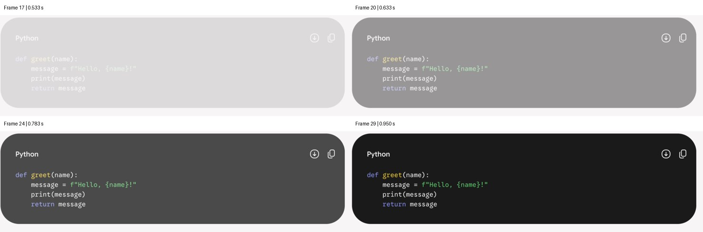
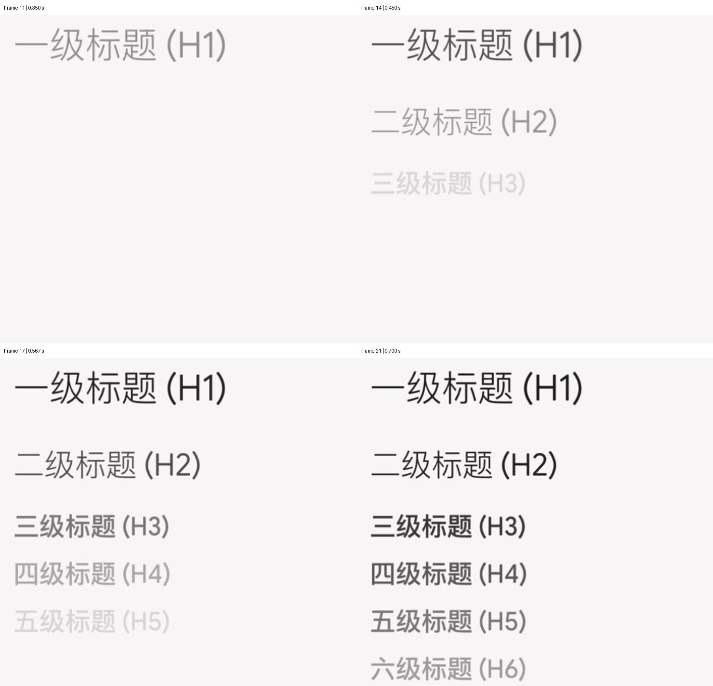
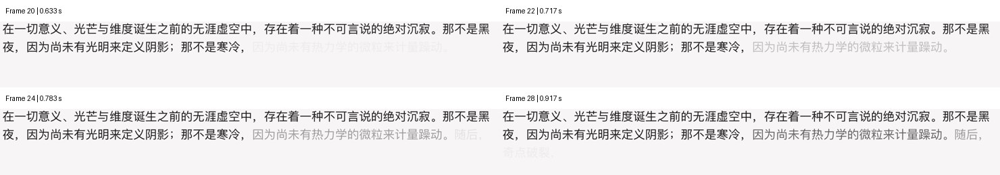

# Gemini streaming 动画分析与 Aether 实现

分析依据：用户提供的三段原始录屏及 `gemini.google.com.har`。录屏中的提示词仅作为观察素材。HAR 的 Cookie、请求头、登录标识及思考过程不进入仓库。

## 逐帧证据

按视频的实际 presentation timestamp 解码，不按容器声明的 60 fps 补帧。三个文件分别解码出 66、58、139 帧，共 263 帧；有效采样约 30 fps，局部间隔不同。因此下述时间精度约一帧，不能反推出屏幕刷新率。

| 录屏 | 内容 | 可观察行为 |
| --- | --- | --- |
| `91F0B36F…`，2.26 秒 | 正文、四行 Python、正文 | 新正文分段淡入；代码框首次可见时已有完整四行和最终高度，背景、文字与工具按钮一起淡入 |
| `0DC9A4EB…`，2.02 秒 | Markdown 标题与列表 | 每个标题内部亮度接近一致；多行标题同时处于不同淡入阶段，不是当前一行完成后才开始下一行 |
| `88B86DC4…`，4.74 秒 | 连续中文长文 | 同一短片段里的字一起变深，跨行仍可保持相同亮度；新旧片段的淡入重叠形成渐变尾部 |

代码背景约在 0.533 秒达到最终对比度的 5%，0.667 秒达到 50%，0.950 秒达到 95%；5%→95% 约 417 毫秒。其几何尺寸在这段时间不变。

H1 的 5%→95% 约为 0.250→0.567 秒；H2 为 0.383→0.700 秒。新标题出现时，上面的标题仍在淡入。

例如“因为尚有热力学的微粒来计量躁动。”的不同横向采样区域具有近似的亮度曲线，约在 0.683→1.183 秒完成 5%→95%。这支持“短片段独立淡入”，不支持“每个字固定间隔依次打出”。一些片段也存在更快的收尾，不能把所有区域解释成同一个固定 CSS 动画。

测量方法：选取布局未滚动的稳定帧作为最终字形蒙版，对深色字形像素使用 `(背景亮度－当前亮度)/(背景亮度－最终亮度)` 估算相对透明度，取区域中位数。压缩、抗锯齿及截图颜色空间会带来误差。原始时间和采样曲线保存在 [frame-measurements.csv](assets/streaming/frame-measurements.csv)。这里测的是透明度变化，没有发现需要增加位移、缩放或模糊动画的证据。

## HAR 证据：网络输出和呈现动画是两层

HAR 有 201 个请求，其中 3 个 `StreamGenerate` 响应对应这三种文本。响应是带长度前缀、`wrb.fr` 封装的 JSON 流，正文位于嵌套载荷的 `[4][0][1][0]`。每次是累计文本快照，取相邻快照差值得到新增字符；不是一条协议记录对应一个 tokenizer token。

| 内容 | 协议记录 | 正文变更次数 | 最终字符数 | 正文增量中位数 | 增量范围 |
| --- | ---: | ---: | ---: | ---: | ---: |
| 长文 | 99 | 60 | 2622 | 44 | 20–58 |
| Markdown | 34 | 28 | 1538 | 45 | 2–149 |
| 四行代码示例 | 12 | 6 | 200 | 32 | 3–68 |

字符数按 Python Unicode 字符统计，包含 Markdown 源码；不等同于 token 数、UTF-16 长度或字节数。协议记录还含有状态、重复结果等，因此记录数不等于正文更新数。

长文前三次累计长度为 29、76、119。服务端会在“不可 / 言说”和“计量 / 躁动”之间切开，说明网络分块本身并非严格按完整句子划分。

代码示例增量长度为 `4, 27, 61, 68, 37, 3`。第三次更新已有开头围栏及 `def greet(name):`，第四次才补完四行并闭合围栏。载荷 `[26]` 还提供结构化段落/代码节点，第三次更新中代码节点仍不完整。因此视频中代码块完整尺寸的首次出现，不能简单归因于“服务端整块发送代码”；呈现层存在合并/延后显示的迹象。

HAR 只保存请求整体的 wait/receive 时长和合并后的响应体，没有每条记录独立的到达时间。长度前缀是应用协议边界，也不能等同于 TCP 包或 HTTP/2 DATA 帧。具体前端定时器、缓冲阈值和 CSS easing 无法从这些材料证明。

## Aether 的复刻策略

旧实现的 Android 和 iOS 各有一个 `activeFadeRange` 与 `Animatable`。每次更新替换范围并重置动画，之前还没淡入完成的字立即恢复完全不透明；直接延长同一个动画无法解决这个问题。

新实现将接收文本、呈现批次和绘制透明度分开：

- 使用共享 `StreamingRevealTimeline`，将最多 64 毫秒内的碎更新合并，按标点、换行和短片段建立独立批次。标题作为整行，代码围栏作为整块。这里的 64 毫秒是 Aether 的实现取值，不是声称测得的 Gemini 常量。
- 每批保留独立起始时间，以 400 毫秒 smoothstep 曲线淡入。新增内容不会重置旧批次。一大段同时抵达时，片段起始时间最多错开 160 毫秒，避免人为排队数秒。
- 完整 Markdown 已参与布局，动画只改变绘制透明度。源码位置映射经过粗体、链接、行内代码解析后仍保留；透明度蒙版保持原有颜色、选择和点击行为。
- 逐帧时钟只在绘制/图层读取；Markdown 解析及文字布局不随每帧透明度重新执行。蒙版路径按布局和批次缓存，完成的批次被清理。
- 短代码围栏最多等待 240 毫秒，尽量等闭合再让背景和代码整体淡入；慢流或未闭合代码到时仍显示，避免长期空白。长代码后续内容继续按实际到达增长。
- 结束时刷新尚未展示的内容，并继续收完已有动画。Android 在 pending 列表项转换成已保存消息时，通过会话内的有限缓存接续相同文本的淡入。历史消息不重播；重试/替换清理旧位置；系统 Reduce Motion 直接显示当前文本。

参数是依据录屏做出的近似复刻。数学 WebView 采用整块淡入；图片、Mermaid 和复杂表格的加载/重排保留既有实现，不能从这些录屏推断它们在 Gemini 中的行为。

## 验证

共享回归覆盖高频碎片、重叠淡入、结束刷新、代码闭合/超时、大批量积压、重试替换、历史消息、源码映射及 Unicode。Android 与 iOS 的 Markdown 入口分别接入共享呈现机制。具体构建、测试与设备安装结果见本次交付说明。
